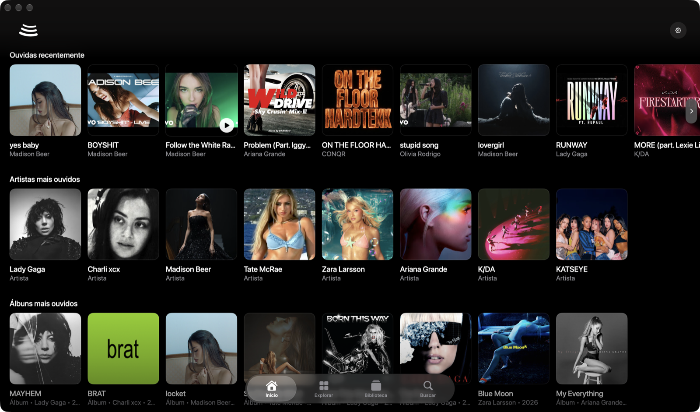
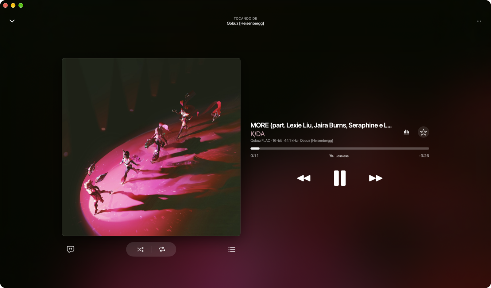
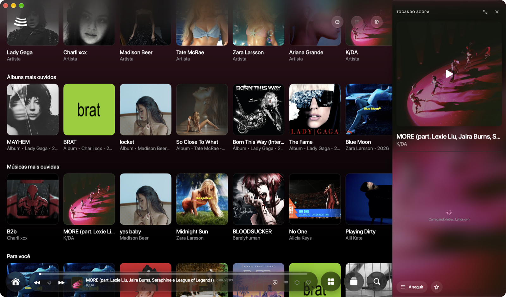
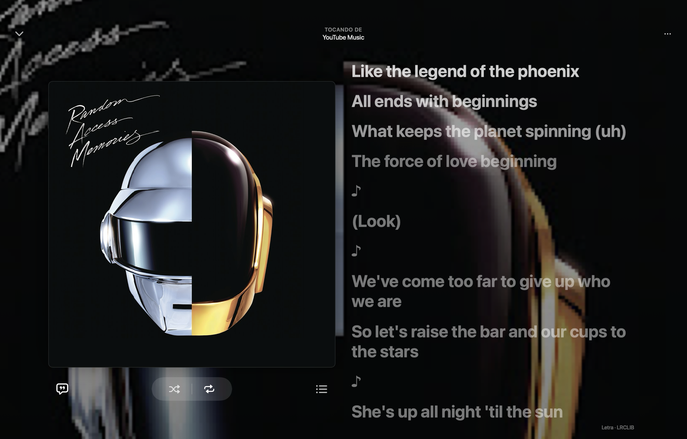
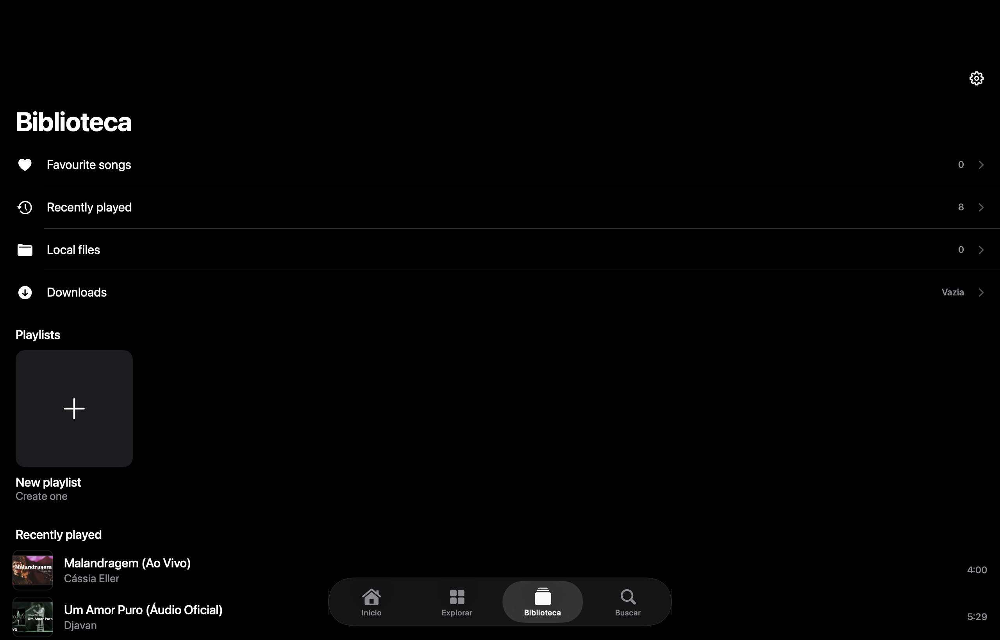
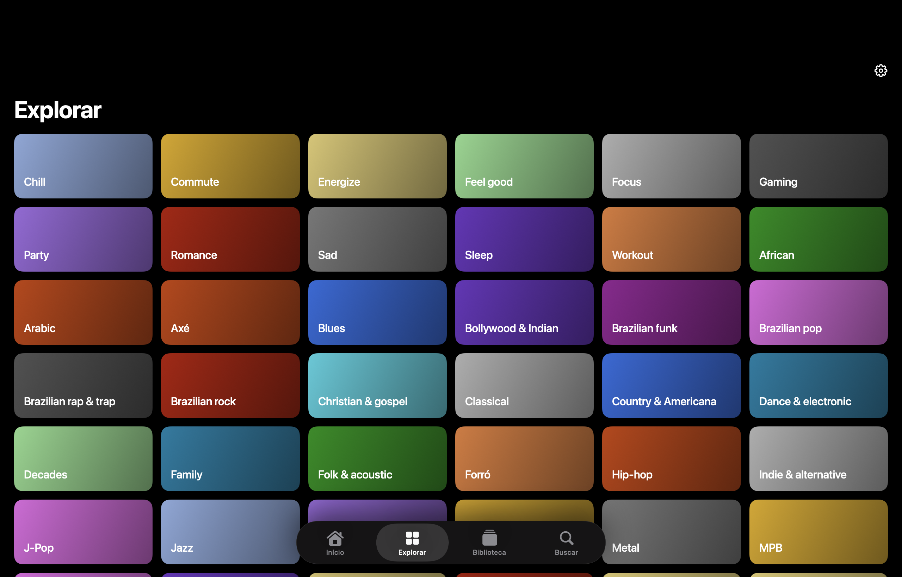
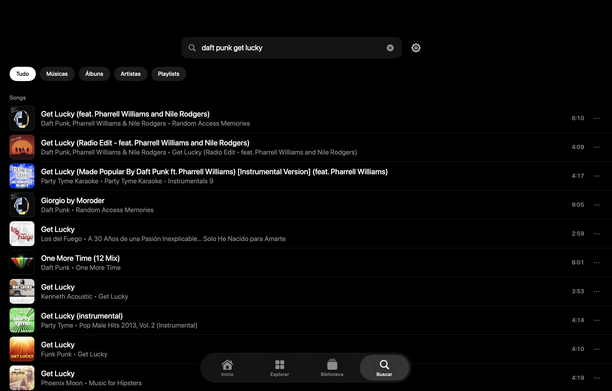
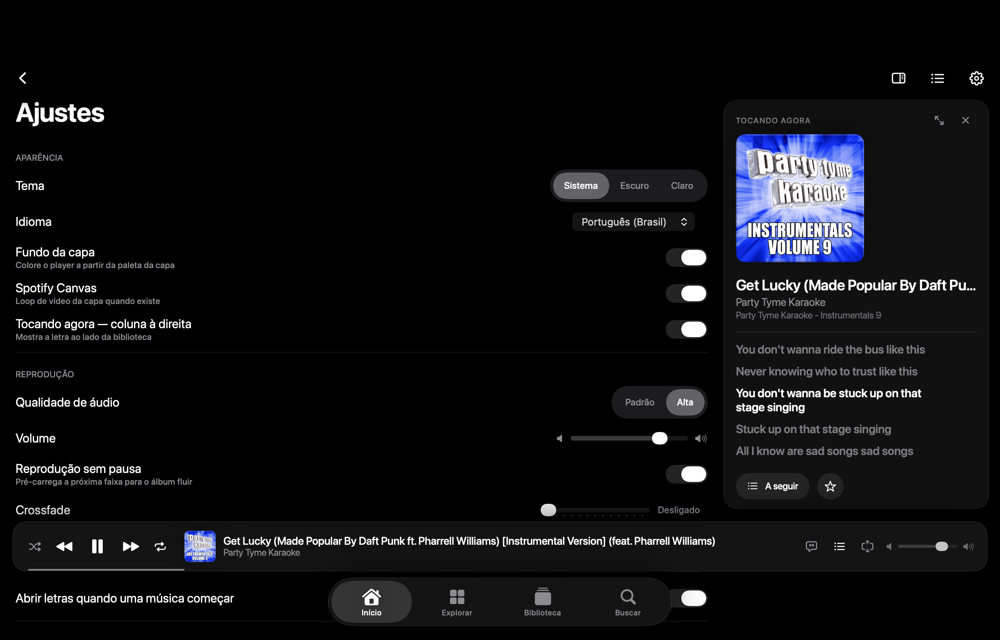
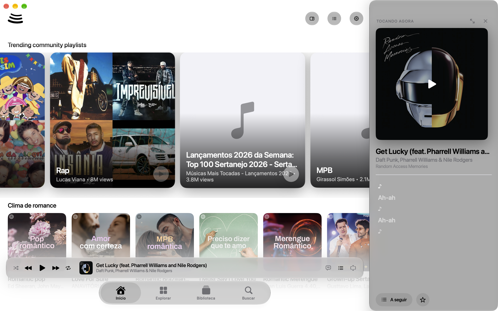
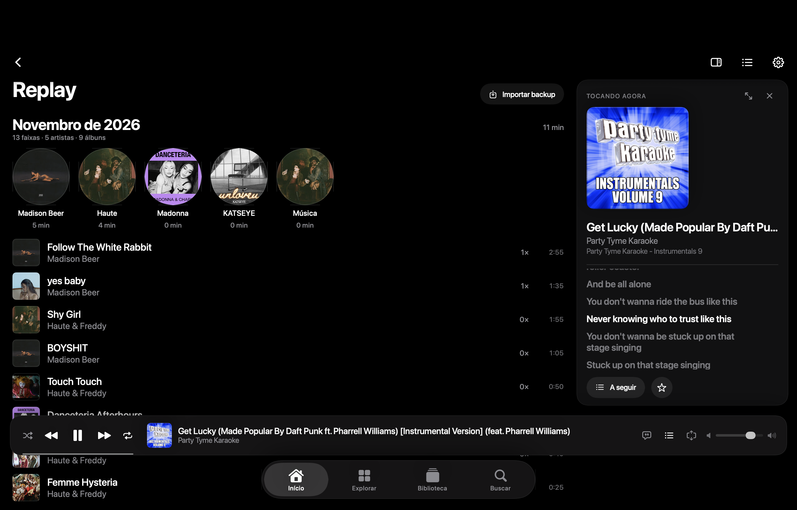

# BitGranada — BitChord para macOS (Apple Silicon)

**BitGranada é a versão do [BitChord](https://github.com/kushagrasinghx/BitChord) para macOS em chips ARM
(arm64).** O BitChord é um cliente de YouTube Music para Android (Kotlin + Jetpack Compose); o BitGranada
é uma adaptação **nativa** dele para o Mac, em Swift + SwiftUI, mantendo o visual da versão de celular.

Não há Electron, não há JVM, não há projeto Xcode: é um binário Mach-O `arm64` compilado com `swiftc`,
empacotado como `BitGranada.app`, sem nenhuma dependência para instalar.

- **Versão:** 2.0 (build 200)
- **Alvo:** macOS 14+, Apple Silicon
- **Idioma:** Português do Brasil (traduzido automaticamente para o idioma do sistema)
- **Licença:** GPLv3

---

## Telas

| Início | Player em tela grande |
|---|---|
|  |  |

| Coluna "Tocando agora" (letra, clipe e canvas) | Letras sincronizadas |
|---|---|
|  |  |

| Biblioteca | Explorar |
|---|---|
|  |  |

| Busca | Ajustes (PT-BR) |
|---|---|
|  |  |

| Modo claro | Replay importado do Android |
|---|---|
|  |  |

---

## O que ele faz

### Reprodução — a ordem das fontes

| # | Fonte | Formato |
|---|---|---|
| 1 | **Addon Qobuz** | FLAC / Hi-Res até 24-bit |
| 2 | **JioSaavn** (embutido) | AAC 320 kbps |
| 3 | **YouTube Music** | AAC (último recurso) |

O addon é consultado primeiro, o JioSaavn entra pela API web do próprio serviço e o YouTube Music fecha a
cadeia. O rótulo ao lado da faixa mostra sempre quem respondeu: `Qobuz FLAC · 16-bit · 44.1 kHz`,
`JioSaavn · 320 kbps` ou `AAC · YouTube Music`.

Crossfade, gapless, equalizador, normalização, ganho por faixa e fades de pausa ficam em
**Ajustes → Reprodução**.

### Vídeo e arte de fundo

- **Clipe do YouTube** na capa do álbum, **mudo**, seguindo o relógio da música (seek quando o desvio
  passa de 0,45 s, ajuste fino de `rate` abaixo disso). Só entram clipes de **canais oficiais** do
  artista ou canais verificados.
- **Canvas do Spotify** e **motion artwork da Apple Music** como fundo animado, na maior resolução que a
  fonte oferece: o master HLS é lido e a variante de maior área é escolhida.
- Enquanto o clipe carrega, a capa continua na tela — o vídeo só aparece quando tem primeiro quadro.

### Letras

Fontes em cascata: lrc.red, BiniLyrics, LyricsPlus, Unison, KuGou, LRCLIB, YouTube Music e, por último,
**Lyrics.ovh** (texto completo, sem sincronia). Cada candidato passa por **validação de tempo** contra a
duração real da faixa: se as marcações não puderem pertencer àquela gravação, o app descarta a sincronia,
tenta a próxima fonte e, no fim, mostra a letra **sem sincronia** em vez de deixar o painel vazio.

### Last.fm

Com a sua conta (`Ajustes → Last.fm`), a Home abre com as prateleiras **Ouvidas recentemente**, **Artistas
mais ouvidos**, **Álbuns mais ouvidos** e **Músicas mais ouvidas**, todas com capa resolvida pelo YouTube
Music. Sem conta, o app usa o grafo de similaridade para montar "Parecido com <artista>".

O botão **Estatísticas** no player mostra ouvintes, execuções, álbum e tags do Last.fm, e — do lado do app
— a fonte e o formato que estão tocando naquele momento.

### Biblioteca e o resto

Favoritos, playlists, downloads offline, letras salvas, histórico, backup JSON (inclusive importando o
backup do BitChord de Android), armazenamento e cache com orçamento, e aparência com liquid glass.

---

## Como compilar e rodar

Requisitos: macOS 14+ em Apple Silicon e os **Command Line Tools** (`xcode-select --install`).
Xcode completo não é necessário.

```bash
./scripts/build.sh --run     # compila e abre dist/BitChord.app
./scripts/build.sh           # só compila (release, -O -whole-module-optimization)
./scripts/build.sh --debug   # build rápido para editar
```

O script detecta sozinho o SDK que combina com o toolchain instalado e guarda a escolha em `build/.sdk`.

Para gerar o pacote distribuível:

```bash
ditto -c -k --sequesterRsrc --keepParent dist/BitGranada.app \
      dist/BitGranada-2.0-macos-arm64.zip
```

---

## Estrutura

```
BitChord/             fontes Swift (o nome da pasta veio do projeto original)
  ShellView.swift     janela, abas, mini player
  NowPlayingView.swift, NowPlayingRail.swift   player e coluna lateral
  PlayerEngine.swift  áudio, fila, crossfade
  ClipEngine.swift    clipe do YouTube (mudo, sincronizado)
  Canvas.swift        canvas e motion artwork
  Lyrics.swift        cascata de letras com validação de tempo
  InnerTube.swift     YouTube Music + YouTube (busca, streams)
  JioSaavn.swift      fonte de áudio JioSaavn
  LastFM.swift        recomendações e estatísticas
  DetailViews.swift   álbum, artista, playlist e Ajustes
scripts/build.sh      compilação e empacotamento
docs/                 capturas de tela e notas
```

---

## Limites conhecidos

- **Clipes oficiais (OMV)** costumam ser recusados pelo próprio YouTube fora do site (`LOGIN_REQUIRED`),
  mesmo com sessão válida. Quando isso acontece, a capa/canvas continua no lugar do vídeo.
- Os streams de vídeo são consumidos via **HLS**: os formatos adaptativos são fragmentos DASH que o
  AVFoundation não abre (medido — o item fica em `.unknown`).
- O Spotify Web API limita este tipo de IP; o canvas tem esfriamento de 10 minutos quando isso acontece.

---

## Créditos

- Projeto original: [BitChord](https://github.com/kushagrasinghx/BitChord) (Android, GPLv3).
- Metadados e letras: YouTube Music, LRCLIB, lrc.red, LyricsPlus, Unison, KuGou, Lyrics.ovh.
- Last.fm Web API para recomendações, histórico e estatísticas.

GPLv3 — veja [LICENSE](LICENSE).
